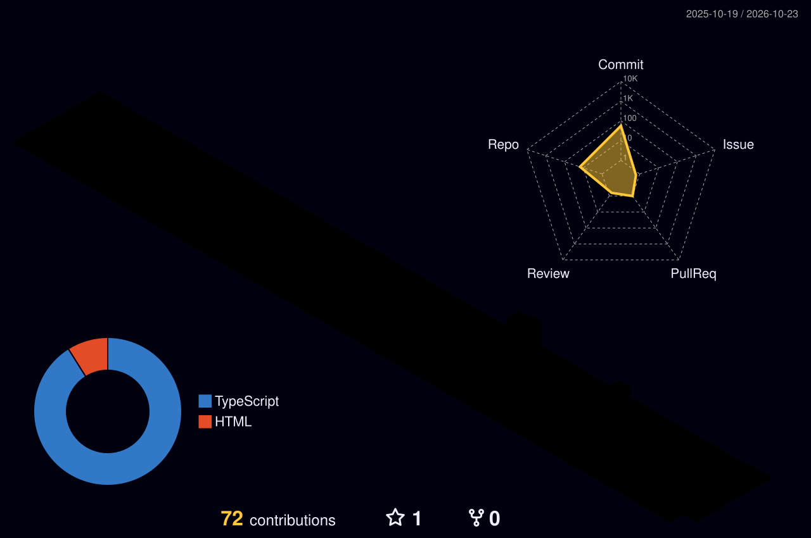

  

  
  &nbsp;
  
  &nbsp;
  

 

---

## What I Build

**AI-powered systems and premium web products** — specifically the kind where the architecture has to be solid because the UX demands it. I care about root-cause solutions, not patches. If it's clumsy, it gets rejected.

- 🏗️ **Right now:** [Workout OS](https://github.com/oviraraptosarus/workoutos-v2) — voice-first, AI-powered fitness & life tracking system. Built around state machines that actually handle Android Web Speech API edge cases, not around them.
- 🤖 **Also shipping:** [Duxio](https://github.com/oviraraptosarus/duxio-client-acquisition-os) — B2B client acquisition engine. Autonomous outreach, real pipeline.
- ⚙️ **Philosophy:** Trillion-dollar co design standards or nothing. Zero clutter. Zero workarounds.

---

## Stack

  

 

  

---

## Stats

  

 

  
  &nbsp;
  

 

  

---

## 3D Contribution Map

  

---

## Contribution Snake

  <picture>
    <source media="(prefers-color-scheme: dark)" srcset="https://raw.githubusercontent.com/oviraraptosarus/oviraraptosarus/output/github-snake-dark.svg" />
    <source media="(prefers-color-scheme: light)" srcset="https://raw.githubusercontent.com/oviraraptosarus/oviraraptosarus/output/github-snake.svg" />
    
  </picture>

---

  

  <i>"Is this something a multi-trillion dollar company would do? If it's clumsy, it's rejected."</i>

